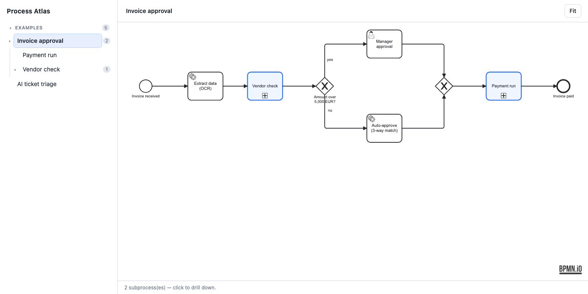
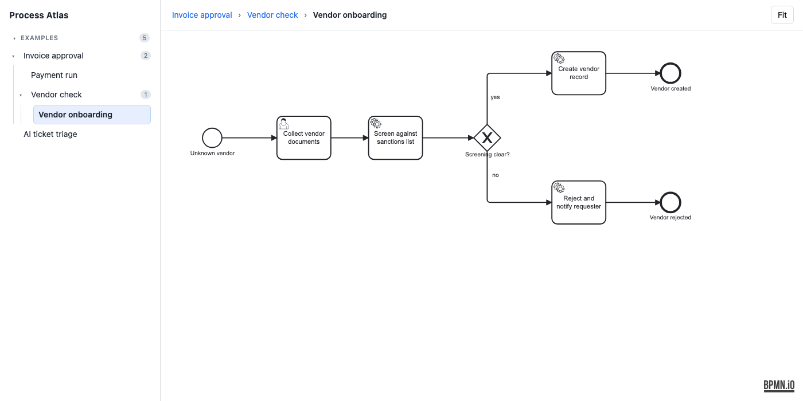

# Process Atlas

Browse BPMN 2.0 diagrams in the browser and drill down: a click on a call
activity opens the process it calls, even when that process lives in another
file. The source of truth is a directory of plain `.bpmn` files; nothing is
generated that is not in them.



## The problem

Process models rarely fit on one page. BPMN solves this with call activities
(a task that stands for a whole other process), but most viewers open one file
at a time and leave you to find the referenced model yourself. Process Atlas
indexes a whole directory by *process ID*, so a call activity is a link.

Drilling down two levels (`Invoice approval` → `Vendor check` → `Vendor
onboarding`), with the breadcrumb and the sidebar tree following along:



## What it does

- Serves `.bpmn` files from `diagrams/<group>/` and renders them with
  [bpmn-js](https://bpmn.io/toolkit/bpmn-js/) (read-only viewer by default).
- Resolves `callActivity/@calledElement` against `process/@id` across all
  files. Call activities with a resolvable target are highlighted and
  clickable; an unresolvable target is drawn red and dashed instead of
  pointing at nothing.
- Builds the sidebar as a call tree. A process nobody calls is an entry point
  (`is_root`); the entry point with the most calls opens first.
- Optional edit mode (`ATLAS_EDIT=1`) with the bpmn-js modeler, "New" and
  "Save". The editor code is loaded only in edit mode.
- `GET /health` returns 503 when the diagram directory is empty or a file does
  not parse, which a plain process check would not notice.

## Data format

Plain BPMN 2.0 XML. The only convention Process Atlas adds is that a
`calledElement` is the ID of a process in the same corpus:

```xml
<bpmn:process id="invoice-approval" name="Invoice approval" isExecutable="false">
  <bpmn:startEvent id="Start" name="Invoice received">…</bpmn:startEvent>
  <bpmn:callActivity id="VendorCheck" name="Vendor check" calledElement="vendor-check">
    <bpmn:incoming>Flow_2</bpmn:incoming>
    <bpmn:outgoing>Flow_3</bpmn:outgoing>
  </bpmn:callActivity>
  …
</bpmn:process>
```

`diagrams/examples/` contains five complete, laid-out examples:
`invoice-approval` calls `vendor-check` and `payment-run`, `vendor-check`
calls `vendor-onboarding`, and `ai-ticket-triage` is a separate entry point
(LLM classification with a confidence gate and human fallback).

The directory under `diagrams/` is the sidebar group; the server derives it
from the path.

## Quickstart

Requirements: [Deno](https://deno.com), [pnpm](https://pnpm.io),
[just](https://github.com/casey/just).

```bash
just install     # frontend dependencies (pnpm)
just build       # Vite bundle into web/dist
just serve       # http://127.0.0.1:8080 — opens the `examples` group
just edit        # same, with New/Save enabled (writes into diagrams/)
just test        # Deno tests
just check       # type check + lint
```

Add your own diagrams by dropping `.bpmn` files into `diagrams/<group>/`.
Files without diagram interchange (no `BPMNShape`) are laid out in the browser
with `bpmn-auto-layout`.

HTTP API (addressed by process ID, not file name):

```
GET  /api/diagrams              list: id, name, repo, file, calls, unresolved, is_root
POST /api/diagrams              create a placeholder (ATLAS_EDIT=1 only)
GET  /api/diagrams/<process-id> the BPMN XML
PUT  /api/diagrams/<process-id> write back (ATLAS_EDIT=1 only)
GET  /api/preview/<id>.png      sidebar preview; 404 if older than the .bpmn
GET  /health
```

Docker: `just up` builds the image and serves on `:8088` (read-only).

## Status and limits

- Early (v0.2). Three test files, 25 Deno tests; no browser tests.
- The write routes check *whether* edit mode is on, not *who* writes. Do not
  expose an instance with `ATLAS_EDIT=1` to a network you do not trust.
- The parser in `server/bpmn.ts` is a tag scanner, not a general XML parser: no
  entity resolution beyond the predefined ones, no schema validation.
- Text annotations are not placed by the browser layout fallback, so files
  without diagram interchange show no notes. The shipped examples carry their
  own layout.
- `just sync`, `just scaffold` and `just previews` are optional helpers that
  pull `.bpmn` files from sibling repositories (`sources.yml`) and rely on an
  external layout pipeline that is not part of this repository. The sidebar
  falls back to rendering previews in the browser without them.
- Some code comments and test fixtures are still in German.

## License

MIT, see [LICENSE](LICENSE). bpmn-js is licensed separately and requires its
watermark to stay visible; Process Atlas does not remove it.
